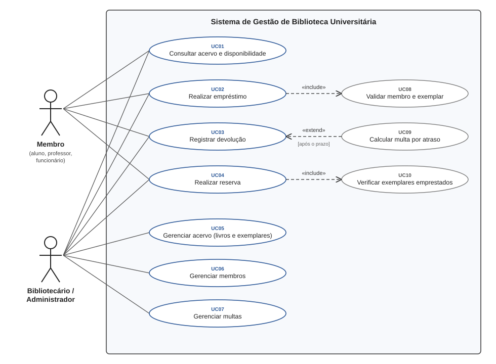

# Especificação de Casos de Uso — Sistema de Gestão de Biblioteca Universitária

- **Aluno:** Uanderson Bueno
- **Disciplina:** 26E4_5 — Projeto de Bloco
- **Entrega:** TP1

## 1. Diagrama de casos de uso

Fonte em PlantUML: [diagrama-casos-de-uso.puml](diagrama-casos-de-uso.puml).

### Atores

- **Membro**: aluno, professor ou funcionário com cadastro. O tipo é um atributo do membro e, nesta versão, não muda as regras (suposição S04), por isso não há atores separados para cada tipo.
- **Bibliotecário/Administrador**: executa as operações administrativas (RN11).

### Lista de casos de uso

| ID | Caso de uso | Atores | Requisitos |
|----|-------------|--------|------------|
| UC01 | Consultar acervo e disponibilidade | Membro, Bibliotecário | RF11, RF12 |
| UC02 | Realizar empréstimo | Membro, Bibliotecário | RF14–RF19 |
| UC03 | Registrar devolução | Membro, Bibliotecário | RF20–RF22, RF29 |
| UC04 | Realizar reserva | Membro, Bibliotecário | RF25–RF28 |
| UC05 | Gerenciar acervo (livros e exemplares) | Bibliotecário | RF01–RF06 |
| UC06 | Gerenciar membros | Bibliotecário | RF07–RF10 |
| UC07 | Gerenciar multas | Membro (consulta), Bibliotecário | RF23, RF24 |
| UC08 | Validar membro e exemplar («include» de UC02) | — | RF16–RF19 |
| UC09 | Calcular multa por atraso («extend» de UC03) | — | RF21 |
| UC10 | Verificar exemplares emprestados («include» de UC04) | — | RF26 |

**Por que «include» e «extend»:** a validação (UC08) acontece **sempre** que se realiza um empréstimo, por isso é um «include». O cálculo de multa (UC09) só acontece **quando há atraso**, por isso é um «extend» de UC03, com a condição de extensão "devolução após o prazo".

---

## 2. UC02 — Realizar empréstimo

| Campo | Descrição |
|-------|-----------|
| **Atores** | Membro (solicita), Bibliotecário (processa) |
| **Objetivo** | Registrar a retirada de um exemplar por um membro. |
| **Pré-condições** | O bibliotecário está usando o sistema. Membro e exemplar estão cadastrados. |
| **Pós-condições** | Empréstimo ativo registrado com prazo de 14 dias; exemplar marcado como emprestado; contador de empréstimos ativos do membro aumentado em 1. |
| **Regras** | RN01, RN03, RN04, RN05, RN10, RN12 |

**Fluxo principal**

1. O membro solicita o empréstimo e apresenta o exemplar ao bibliotecário.
2. O bibliotecário informa ao sistema a matrícula do membro.
3. O sistema localiza o membro e verifica se o cadastro está ativo (UC08).
4. O sistema verifica se o membro tem menos de 3 empréstimos ativos e nenhuma multa pendente (UC08).
5. O bibliotecário informa o código de patrimônio do exemplar.
6. O sistema verifica se o exemplar está em bom estado e sem empréstimo ativo (UC08).
7. O sistema registra o empréstimo com a data de hoje como data de retirada e calcula o prazo (retirada + 14 dias).
8. O sistema exibe o comprovante com título do livro, membro e data limite de devolução.

**Fluxos alternativos**

- **FA1 — Cadastro inválido (passo 3):** a matrícula não existe ou o cadastro está inativo. O sistema exibe "Membro sem cadastro válido" e encerra o caso de uso sem registrar o empréstimo.
- **FA2 — Limite atingido (passo 4):** o membro já possui 3 empréstimos ativos. O sistema exibe "Limite de 3 empréstimos simultâneos atingido", lista os empréstimos ativos do membro e encerra sem registrar.
- **FA3 — Multa pendente (passo 4):** o membro possui multa não paga. O sistema exibe o valor devido e encerra sem registrar. O membro pode quitar a multa (UC07) e reiniciar o caso de uso.
- **FA4 — Exemplar indisponível (passo 6):** o exemplar está danificado, indisponível ou já emprestado. O sistema informa o motivo e mostra se há outro exemplar do mesmo livro disponível. Se houver, o fluxo volta ao passo 5. Se não houver, o sistema sugere a reserva (UC04).

---

## 3. UC03 — Registrar devolução

| Campo | Descrição |
|-------|-----------|
| **Atores** | Membro (solicita), Bibliotecário (processa) |
| **Objetivo** | Encerrar um empréstimo ativo e, se houver atraso, gerar a multa. |
| **Pré-condições** | Existe um empréstimo ativo para o exemplar informado. |
| **Pós-condições** | Empréstimo encerrado com data efetiva de devolução; exemplar disponível (ou danificado); multa registrada se houve atraso. |
| **Regras** | RN02, RN08, RN09, RN10 |

**Fluxo principal**

1. O membro entrega o exemplar ao bibliotecário.
2. O bibliotecário informa o código de patrimônio do exemplar.
3. O sistema localiza o empréstimo ativo do exemplar.
4. O sistema registra a data de hoje como data efetiva de devolução e encerra o empréstimo.
5. O sistema compara a data efetiva com o prazo. Se houver atraso, executa UC09 (Calcular multa por atraso).
6. O bibliotecário confirma que o exemplar está em bom estado e o sistema o marca como disponível.
7. O sistema verifica se há reserva ativa para o livro e, se houver, avisa qual membro tem a reserva mais antiga.
8. O sistema exibe o resumo da devolução.

**Fluxos alternativos**

- **FA1 — Sem empréstimo ativo (passo 3):** o exemplar não está emprestado. O sistema exibe "Não há empréstimo ativo para este exemplar" e encerra sem alterações.
- **FA2 — Devolução com atraso (passo 5, UC09):** o sistema calcula dias de atraso = data efetiva − prazo, gera a multa (dias × R$ 1,00) com situação "pendente", vincula-a ao membro e ao empréstimo e exibe o valor.
- **FA3 — Exemplar danificado (passo 6):** o bibliotecário informa que o exemplar voltou danificado. O sistema marca o exemplar como "danificado", e ele não pode ser emprestado até ser regularizado (UC05). A devolução é concluída normalmente.

---

## 4. UC04 — Realizar reserva

| Campo | Descrição |
|-------|-----------|
| **Atores** | Membro (solicita), Bibliotecário (gerencia) |
| **Objetivo** | Registrar o interesse de um membro em um livro que está emprestado. |
| **Pré-condições** | O livro está cadastrado. |
| **Pós-condições** | Reserva registrada para o livro (não para um exemplar), com a data de hoje. |
| **Regras** | RN06, RN07, RN12 |

**Fluxo principal**

1. O membro consulta o acervo (UC01) e escolhe um livro.
2. O membro solicita a reserva informando sua matrícula.
3. O sistema verifica se o membro tem cadastro válido.
4. O sistema verifica se o livro possui pelo menos um exemplar emprestado (UC10).
5. O sistema verifica se o membro já não possui reserva ativa para o mesmo livro.
6. O sistema registra a reserva com livro, membro e data atual.
7. O sistema informa a posição do membro na fila de reservas do livro.

**Fluxos alternativos**

- **FA1 — Nenhum exemplar emprestado (passo 4):** todos os exemplares estão disponíveis. O sistema exibe "Reserva não permitida: há exemplares disponíveis para empréstimo imediato" e encerra sem registrar.
- **FA2 — Cadastro inválido (passo 3):** o sistema exibe "Membro sem cadastro válido" e encerra.
- **FA3 — Reserva duplicada (passo 5):** o sistema informa que o membro já possui reserva para o livro e mostra a posição atual na fila.

---

## 5. UC01 — Consultar acervo e disponibilidade (resumido)

**Fluxo principal:** o ator informa um termo de busca (título, autor ou ISBN). O sistema lista os livros encontrados com a quantidade de exemplares disponíveis, emprestados e indisponíveis.

**Fluxo alternativo — FA1 (nenhum resultado):** o sistema exibe "Nenhum livro encontrado" e permite uma nova busca.
